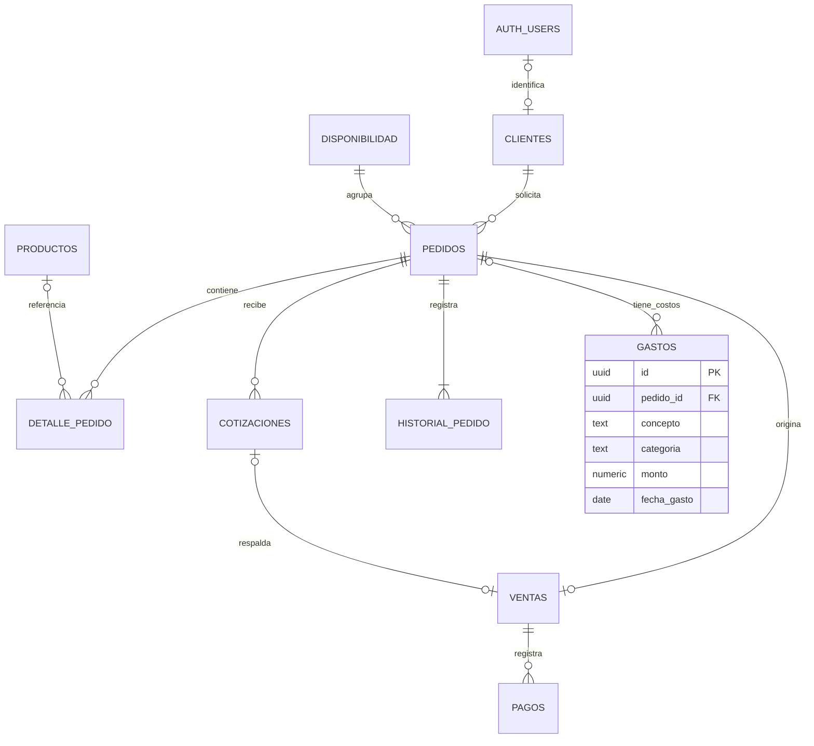

# Base de datos inicial

Estado: creada en Supabase el 16 de septiembre de 2026. Proyecto `ivxeabovtxetvvxgyywa`.

## Archivos reproducibles

- `supabase/migrations/202609160001_base_inicial.sql`: estructura inicial ejecutada manualmente en el editor SQL. No volver a ejecutar sobre las tablas existentes. No se ha registrado como migración aplicada en el historial de Supabase CLI.
- `supabase/tests/base_inicial.sql`: pruebas que usan una transacción y revierten los registros ficticios al finalizar. Reservar la fecha 2099-01-01 para estas pruebas o cambiarlas si ya existe en otro entorno.
- `scripts/generar_resumen_bd.py`: generador del resumen Word, usando python-docx.
- `docs/entregables/Resumen_base_de_datos_Delicias_de_Mama.docx`: resumen académico.

## Relaciones

El historial se genera al dar de alta el pedido y cambiar su estado. Desde el ajuste del 18 de septiembre de 2026, GASTOS puede vincularse opcionalmente con PEDIDOS mediante `pedido_id`. Un pedido puede tener varios gastos; cada gasto corresponde a cero o un pedido. Los gastos generales mantienen `pedido_id = NULL`. auth.users pertenece a Supabase; no se creó ni modificó esa tabla. Una cotización vinculada a una venta debe pertenecer al mismo pedido.

## Ajuste: gastos por pedido (18 de septiembre de 2026)

- Migración: `supabase/migrations/202609180001_gastos_por_pedido.sql`, aplicada manualmente en el editor SQL. No repetirla sobre la base existente.
- Pruebas: `supabase/tests/gastos_por_pedido.sql`, dentro de una transacción con `ROLLBACK`.
- Resultado observado en Supabase: `OK: gasto general y por pedido; FK y RLS verificadas; datos revertidos`.
- Justificación: RF-06 incluye insumos y costos fijos y variables. Se permite atribuir un gasto a un encargo y conservar gastos generales. Es una ampliación del diseño solicitada durante la revisión; el informe original no define esta relación.
- La clave foránea impide referenciar pedidos inexistentes y restringe borrar un pedido con gastos asociados. Se añadió un índice para consultar costos por pedido. Los registros anteriores permanecen sin pedido y no se modificaron importes ni permisos.
- No duplicar el mismo importe completo para repartir una compra entre varios pedidos. Un reparto detallado necesitaría un modelo adicional; esta versión atribuye cada gasto a un solo pedido o al negocio en general.
- La app Android sigue siendo una demo local: seleccionar un pedido al registrar gastos queda pendiente para su integración con Supabase.
- El Word del 16 de septiembre documenta la versión inicial. Este apartado registra el cambio posterior y debe incorporarse a la próxima entrega académica.

## Evidencia de ejecución

El editor SQL devolvió diez filas con `rowsecurity = true`: clientes, cotizaciones, detalle_pedido, disponibilidad, gastos, historial_pedido, pagos, pedidos, productos y ventas.

El script de pruebas devolvió:

> OK: flujo, historial, restricciones y permisos; datos de prueba revertidos

Se probaron:

- Inserción de cliente, disponibilidad, pedido, detalle, cotización, venta y pago.
- Historial de alta y cambio de estado del pedido.
- Rechazo de cantidad cero, gasto negativo y despacho sin dirección.
- Rechazo de una segunda venta del mismo pedido y de dos cotizaciones aceptadas.
- Rechazo de un pago con una venta inexistente.
- RLS en diez tablas y ausencia de los cuatro permisos CRUD para anon y authenticated en cada tabla.

Las pruebas de integridad se ejecutaron con el rol del editor SQL, dentro de una transacción terminada en ROLLBACK. La verificación de permisos consultó los privilegios efectivos; no se simularon todavía sesiones reales de clientes. No se verificaron rendimiento, restauración ni concurrencia.

## Límites explícitos

Las tablas están cerradas a la app: no se han creado políticas operativas ni usuarios administradores. No se dispone todavía de una aplicación Android conectada.

La capacidad diaria se configura sin un valor por defecto. La confirmación transaccional del último cupo, los cambios de estado autorizados, la aceptación de cotizaciones y los límites de cobros y devoluciones requieren lógica adicional. Los totales de venta no se calculan automáticamente desde detalles. Las ventas se relacionan obligatoriamente con un pedido en esta versión; validar si la dueña necesita ventas directas.

Se propone CLP como moneda de la versión inicial. El esquema conserva importes decimales exactos, sin columna de moneda; una futura operación multimoneda necesita una migración. No se implementaron pasarela de pago, stock de insumos, notificaciones ni respaldos automáticos.

## Revisión del Word

Se generó y comprobó la estructura del DOCX. La revisión visual con el renderizador de la habilidad de documentos quedó bloqueada porque no está disponible LibreOffice (`soffice.exe`) en el entorno. No se ha verificado el número final de páginas ni su apariencia renderizada.
